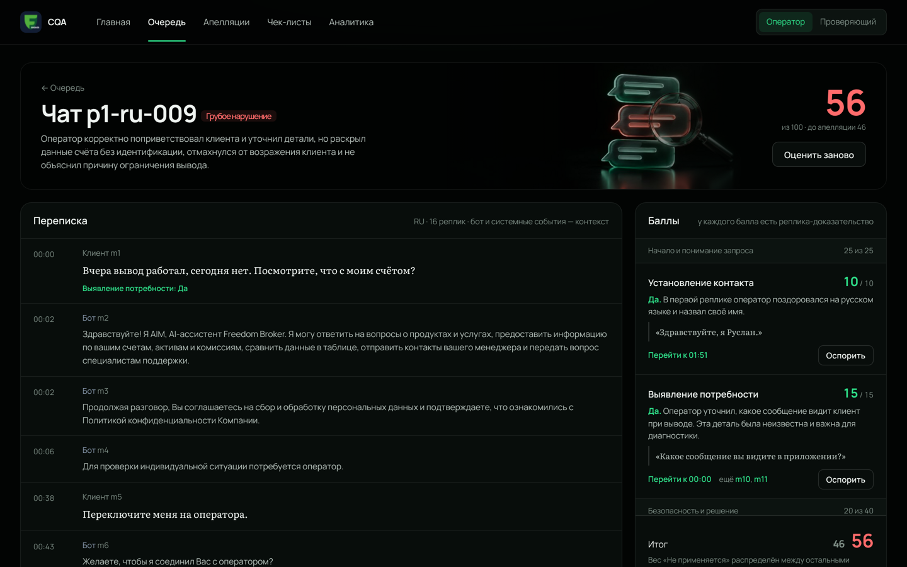
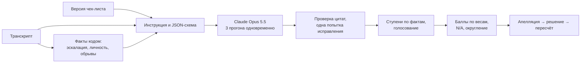

# CQA · контроль качества диалогов Freedom Broker

Прототип Conversation Quality Analytics. Модель оценивает работу оператора в чатах и звонках на русском, казахском и английском по чек-листу, который настраивается в интерфейсе. У каждого балла есть объяснение и реплика-доказательство. Оценку можно оспорить: проверяющий решает, итог пересчитывается.



## Коротко

- **Модели.** Оценка — Claude Opus 5.5. Подсказки в реальном времени, клиент в тренажёре и планы развития — Claude Haiku 5.5.
- **Стоимость одной оценки** с учётом всех вызовов: ≈ $0,12–0,19 за чат и ≈ $0,19–0,30 за звонок (три прогона с голосованием, при расхождении добор до пяти); ≈ $0,04 в режиме «1 прогон».
- **Обоснованность.** У каждого балла — реплика-доказательство и дословная цитата, код сверяет их с транскриптом. В последнем полном прогоне DEV так обоснованы 520 из 520 оценок, все 65 диалогов прошли проверку без замечаний.
- **Работа на новых разговорах.** Проверяем на диалогах, которых не было при настройке: 24 из 24 метаморфных тестов (одна правка — оценка сдвигается ровно там, где должна), 16 из 16 контрастных диалогов и 18 из 19 пар, выведенных из текста чек-листа. Совпадение с рабочей разметкой DEV — около 95% (не официальный эталон, только проверка регрессий; [docs/ACCURACY.md](docs/ACCURACY.md), сырые прогоны — [data/results/v12](data/results/v12/README.md)).
- **Процесс.** Каждая оценка — живой вызов модели по выбранной версии чек-листа. Это видно в интерфейсе: прямой эфир и журнал «Как получена оценка».

## Запуск

Нужен Python 3.11+.

macOS / Linux:

```bash
python3 -m venv .venv && .venv/bin/pip install -r requirements.txt
```

```bash
cp .env.example .env    # впишите ANTHROPIC_API_KEY, при желании — CQA_API_URL
```

```bash
.venv/bin/python -m app.server
```

Windows (PowerShell):

```powershell
py -m venv .venv; .venv\Scripts\pip install -r requirements.txt
```

```powershell
copy .env.example .env   # впишите ANTHROPIC_API_KEY, при желании — CQA_API_URL
```

```powershell
.venv\Scripts\python -m app.server
```

Откройте [127.0.0.1:8000](http://127.0.0.1:8000). При первом запуске в базу `data/cqa.db` загружаются DEV (65 диалогов) и чек-лист организаторов. Без ключа API интерфейс, чек-листы и апелляции работают, только оценку запустить нельзя — интерфейс об этом говорит.

| Переменная | Зачем | По умолчанию |
|---|---|---|
| `ANTHROPIC_API_KEY` | ключ Claude API | — |
| `CQA_API_URL` | адрес GET из гайда организаторов: набор по `group_id` грузится через сервер, без CORS | — |
| `CQA_MODEL`, `CQA_EFFORT`, `CQA_VOTES`, `CQA_EXTRA_VOTES` | модель, усилие, число прогонов и добор при расхождении | `claude-opus-5-5`, `high`, `3`, `2` |
| `CQA_WORKERS` | сколько диалогов оценивается одновременно | `3` |
| `PORT`, `CQA_DB` | порт и путь к базе | `8000`, `data/cqa.db` |

## Функции задания

| | Функция | Где и как |
|---|---|---|
| 01 | Чек-лист | «Чек-листы»: критерии, формулировки «Да» и «Нет», вес, тип ответа (да/нет, шкала, грубая ошибка), ступени шкалы, N/A и его условие. Сумма весов проверяется до сохранения. Каждое сохранение — новая версия, старые оценки остаются со своей. |
| 02 | Оценка диалога | Набор по `group_id`, файлом или вставкой JSON, в том числе один транскрипт. Версия чек-листа выбирается рядом с кнопкой «Оценить». Реплики бота и системные события — контекст, оценивается только оператор. |
| 03 | Результат | По каждому критерию: ответ, баллы с учётом веса, объяснение, цитата и ссылка на реплику; для пропущенного действия — проверенный участок; для N/A — причина и перераспределённый вес. Итог, секции, грубое нарушение — отдельным флагом. |
| 04 | Карточка | Из очереди — к транскрипту и результату. «Перейти к 02:51» прокручивает к реплике; у звонка запись перематывается на это место. |
| 05 | Апелляция | Роль «Оператор»: «Оспорить» у критерия с комментарием. Проверяющий видит спорную оценку, комментарий и фрагмент диалога. |
| 06 | Решение | Роль «Проверяющий»: подтвердить или изменить оценку с причиной, итог пересчитывается. В карточке — исходная оценка, решение и финальный итог. |

Контрольный набор: «Главная» → «Добавить диалоги» → «API организаторов» → предпросмотр → импорт → в очереди «Оценить неоценённые». Замена критерия: «Чек-листы» → правка → «Сохранить версию» → «Применить к набору».

### Импорт с предпросмотром

На главной или в очереди нажмите «Добавить диалоги». Выберите JSON-файл, вставку JSON или API организаторов. По умолчанию создаётся отдельный набор; повторное имя или `dataset_group_id` не объединяет его с существующим.

«Проверить и посмотреть» показывает языки, каналы, первые реплики каждого диалога и ошибки с номерами реплик. Проверяются все записи; при любой ошибке импорт целиком блокируется. Предпросмотр ничего не сохраняет и действует 30 минут.

При явном выборе существующего набора нужно подтвердить добавление. Совпадающие ID можно только пропустить; исходные тексты и оценки не перезаписываются. Для изменённых версий создайте отдельный набор. Если целевой набор изменился после предпросмотра, выполните проверку повторно. Импорт не запускает платную оценку.

### Выгрузка для сдачи

В очереди нажмите «Выгрузить для сдачи», укажите команду, DEV или контроль и версию чек-листа. Нужна версия с восемью исходными критериями, весами и шкалами организаторов. Если в наборе не 65 диалогов (60 чатов и 5 звонков) для DEV или не 10 чатов для контроля, выгрузка предупредит, но не заблокирует. Берётся последняя готовая оценка выбранной версии: применение новой версии чек-листа или неудачная переоценка её не закрывают.

Скачивается `results.json` в формате JSON 1.0: официальные коды критериев, `true`/`false`/`null` и числовые ступени, объяснения, номера реплик с 1 по полному транскрипту, итог и флаг грубой ошибки. Решения по апелляциям включаются в финальные ответы и обоснования.

Диалог со статусом «Проверить» (цитата не совпала дословно хотя бы в одном прогоне) выгружается с ответами модели по голосованию, в окне выгрузки — предупреждение. Неоценённые диалоги, ошибки API без готовой оценки, оценки только по другой версии чек-листа и ссылки на несуществующие реплики остаются отдельными записями `status: "error"`, с `criteria: []`, `score: null` и причиной. Скачивание с такими записями требует явного подтверждения. Сохраните файл как `results/dev/results.json` или `results/prod/results.json` и выполните commit и push самостоятельно.

## Сверх задания

- **Прямой эфир.** Критерии появляются в карточке по мере того, как модель их пишет; доказательства подсвечиваются в транскрипте.
- **Три прогона одновременно, при расхождении — пять.** Ответ по большинству, у шкал — по медиане. У каждого критерия видно согласие прогонов, фильтр «Модель сомневается» собирает спорные диалоги.
- **«Как получена оценка».** Что ушло в модель, её сырые ответы, токены и стоимость, факты, посчитанные кодом. В чек-листе «Что получит модель» показывает инструкцию до запуска.
- **«Как надо было ответить».** У проваленного критерия модель пишет реплику оператора; «Проверить» оценивает копию диалога с ней и показывает итог до и после. «Изменить» у любой реплики — ручная правка с переоценкой копии.
- **Второе мнение по апелляции.** Модель перечитывает спорный критерий с учётом довода оператора и предлагает ступень; решение остаётся за проверяющим.
- **Суфлёр и тренажёр.** Оператор ведёт чат с клиентом из реального диалога или с клиентом-симулятором на Haiku. Проверки кодом на каждое нажатие останавливают нарушение до отправки («Стоп: сведения о счёте до подтверждения личности»). Haiku на каждом ходе подсказывает по критериям и даёт три готовых варианта ответа, около $0,002 за чат. Готовый чат уходит обычному оценщику.
- **Операторы.** Карта навыков «операторы × критерии» со строкой команды, причины снижений со ссылками, план развития от Haiku, «Потренировать на худшем чате».
- **Голос оператора в звонках.** Claude звук не принимает, поэтому запись разбирает код: волна звонка с отрезками оператора и клиента, темп речи, доля речи, интонация, громкость, паузы без предупреждения. Справочно, в баллы не входит.
- **Аналитика и выгрузка.** Выполнение критериев по языкам и каналам, сверка с разметкой команды, CSV/JSON с ответами модели и финальными после апелляций.

## Как устроено



- **Модель отвечает фактами, код считает.** Ответ всегда соответствует JSON-схеме, собранной из текущей версии чек-листа: новый критерий попадает в инструкцию и схему без правки кода. По выявлению потребности, консультации, ведению диалога, эмпатии и завершению модель перечисляет факты (вопросы клиента и закрыт ли каждый, сбои оператора, выразил ли клиент недовольство, было ли прощание), а ответ по правилам чек-листа выводит код (`cqa/derive.py`). Итог, перераспределение веса N/A и округление — тоже код (`cqa/scoring.py`).
- **Доказательства проверяются.** Цитата должна дословно встречаться в реплике, снижение — опираться на реплику оператора, N/A по завершению — на событие обрыва (`cqa/verify.py`). При нарушении модель исправляет ответ один раз, иначе результат помечается «Проверить».
- **Апелляции не переписывают оценку модели.** Финальный итог считается поверх неё по решениям проверяющего.
- **Без фреймворков и сборки.** Сервер — стандартная библиотека Python, хранение — SQLite, интерфейс — HTML, CSS и ES-модули. Адрес API задаётся атрибутом `data-api` у `<body>`, поэтому страницу можно встроить в Dynamics 365 как веб-ресурс, а сервер оценки держать отдельно.

```
app/       сервер, хранилище, задания оценки; суфлёр, подсказки, голос, карта навыков
cqa/       оценщик: промпт и схема из чек-листа, факты, ступени, проверка доказательств, баллы
public/    интерфейс (index.html, cqa.css, js/pages/*); viewer.html и annotations.html — просмотрщики разметки
config/    чек-лист организаторов и экспериментальные версии
data/      рабочая разметка DEV, наборы для проверок вне DEV, сырые прогоны v12 (data/results)
scripts/   CLI-прогоны, метаморфные тесты, отчёты точности
tests/     тесты, включая полный путь через HTTP с подменённой моделью
docs/      точность, решения, демонстрация за 5 минут, исходные материалы, история
```

## Точность и стоимость

| | Opus 5.5 |
|---|---|
| Совпадение по критериям, DEV | 94,8% (1 прогон) · 94,6% (3 прогона + добор) |
| Все 8 оценок совпали | 44 из 65 (1 прогон) · 45 из 65 (3 прогона + добор) |
| Метаморфные тесты: правка диалога → ожидаемая смена оценки (8 мутаций × 3 диалога) | 24 из 24 |
| Пары из текста чек-листа: один момент — разный ответ (17 диалогов, RU/KZ/EN) | 18 из 19, одна спорная |
| Контрастные диалоги вне DEV | 16 из 16 |
| Стоимость, 3 прогона (с добором до 5 при расхождении) | ≈ $0,12–0,19 чат, ≈ $0,19–0,30 звонок |
| Стоимость, 1 прогон | ≈ $0,04 чат |
| Время оценки (прогоны идут одновременно) | 15–40 с |

Перед одновременными вызовами сервер один раз записывает кэш инструкции — около $0,10 за запуск; без этого каждый вызов платил бы за запись сам ($0,42 против $0,19 за один и тот же звонок).

DEV служит регрессионным набором, а не независимым тестом: в правилах только формулировки чек-листа и памятки, без фраз из DEV и без примеров в промпте. Переносимость проверяем на наборах вне DEV и метаморфными тестами.

## Критерии отбора

| Критерий | Что сделано |
|---|---|
| Обоснованность и точность | У каждого балла реплика и цитата, проверенные кодом (520 из 520). Факты событий считает код, ступени «размытых» критериев выводятся из фактов по правилам чек-листа, три прогона с голосованием, проверка цитат. |
| Функциональность | Все шесть функций задания в интерфейсе, плюс прямой эфир, суфлёр и тренажёр, второе мнение, подсказка «как надо было ответить», карта навыков, голос оператора. |
| Удобство | Очередь со статусами и фильтрами, транскрипт и баллы рядом, переход к реплике и месту записи в один клик, роли переключаются вверху. |
| Корректность процесса | Каждая оценка — живой вызов: прямой эфир, журнал с сырым ответом и стоимостью, правка реплики с переоценкой. Импортированные результаты помечены источником. |
| Архитектура | Две модели под разные задачи (Opus — оценка, Haiku — реальное время) и детерминированный код вокруг них. |

## Демонстрация

Порядок показа за 5 минут по плану организаторов — [docs/DEFENSE.md](docs/DEFENSE.md).

## Разработка

```bash
.venv/bin/python -m pytest -q
```

CLI оценщика: `scripts/run_eval.py` (`--dry-run`, `--resume`, `--compare-only`, отчёты по языкам и каналам), метаморфные тесты — `scripts/run_metamorphic.py`. Результаты CLI-прогона можно загрузить в интерфейс: `python -m app.import_run data/runs/<прогон>.json` — они помечаются источником.
